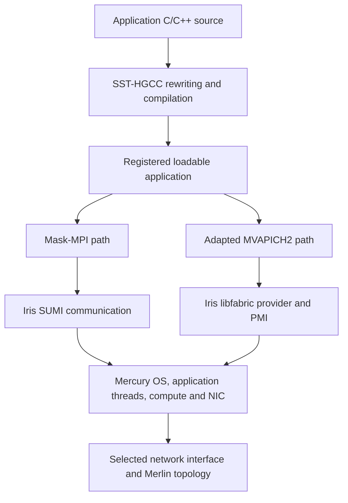

---
{
  "type": "SST Integration Guide",
  "title": "Mercury applications with SST-HGCC and MV2",
  "description": "Choose compiled Mercury applications, Mask-MPI, or an adapted MVAPICH2 stack according to the behavior under study.",
  "tags": [
    "mercury",
    "sst-hgcc",
    "mv2",
    "application",
    "mpi"
  ],
  "status": "draft",
  "generated": {
    "by": "sst-ai-tools/codex",
    "at": "2026-10-07T18:59:42.069301+00:00"
  },
  "sources": [
    {
      "id": "hgcc-readme",
      "resource": "https://github.com/sstsimulator/sst-hgcc/blob/2a37f8c541f02344f7d540188e52efd1f080a6fc/README.md",
      "title": "README.md",
      "x-commit": "2a37f8c541f02344f7d540188e52efd1f080a6fc",
      "x-sha256": "2e282cc0a70f797c92bcdb311be0d42ae1a8d87559efb630bcf9c3ab0f5c390f",
      "x-review-scope": "External checkout inspected locally; not automatically freshness-checked by this repository"
    },
    {
      "id": "hgcc-mv2-driver",
      "resource": "https://github.com/jmlapre/sst-hgcc/blob/41cd313574c994f6fefe2c361124e854b7e4ac0f/hgcclib.py",
      "title": "hgcclib.py",
      "x-commit": "41cd313574c994f6fefe2c361124e854b7e4ac0f",
      "x-sha256": "38014f9f689578219eed44aa4b51ef1c4ad3a5a9a88109428c3f2e830834ffc5",
      "x-review-scope": "External checkout inspected locally; not automatically freshness-checked by this repository"
    },
    {
      "id": "hgcc-mv2-link",
      "resource": "https://github.com/jmlapre/sst-hgcc/blob/41cd313574c994f6fefe2c361124e854b7e4ac0f/hglink.py",
      "title": "hglink.py",
      "x-commit": "41cd313574c994f6fefe2c361124e854b7e4ac0f",
      "x-sha256": "d1bc8eea70077debc697fa0db9eccc766fa39158e9a4cbfb704f9baccfab33d5",
      "x-review-scope": "External checkout inspected locally; not automatically freshness-checked by this repository"
    },
    {
      "id": "mv2-run",
      "resource": "https://github.com/jmlapre/sst-hgcc/blob/41cd313574c994f6fefe2c361124e854b7e4ac0f/tests/mv2/_mv2_run_common.sh",
      "title": "tests/mv2/_mv2_run_common.sh",
      "x-commit": "41cd313574c994f6fefe2c361124e854b7e4ac0f",
      "x-sha256": "31654eb79aaa0a9495c5e3292fc09f24e81856c310adb0ddd101957c90b33ddb",
      "x-review-scope": "External checkout inspected locally; not automatically freshness-checked by this repository"
    },
    {
      "id": "mv2-driver",
      "resource": "https://github.com/jmlapre/sst-hgcc/blob/41cd313574c994f6fefe2c361124e854b7e4ac0f/tests/mv2/run_test_mv2_allreduce.py",
      "title": "tests/mv2/run_test_mv2_allreduce.py",
      "x-commit": "41cd313574c994f6fefe2c361124e854b7e4ac0f",
      "x-sha256": "5e311583388cf91186e7f04793b1436a8bb3cd43a1f2cd6db68a6531628ff75b",
      "x-review-scope": "External checkout inspected locally; not automatically freshness-checked by this repository"
    },
    {
      "id": "mv2-oracle",
      "resource": "https://github.com/jmlapre/sst-hgcc/blob/41cd313574c994f6fefe2c361124e854b7e4ac0f/tests/mv2/test_mv2_allreduce.c",
      "title": "tests/mv2/test_mv2_allreduce.c",
      "x-commit": "41cd313574c994f6fefe2c361124e854b7e4ac0f",
      "x-sha256": "a8b2444b1017b523efce638ba222524e9b5ada8d05b3a62433594f903b365eed",
      "x-review-scope": "External checkout inspected locally; not automatically freshness-checked by this repository"
    },
    {
      "id": "mv2-readme",
      "resource": "https://github.com/nab880/mv2-test/blob/0bd13efd074affc7c8e3cca5add42af699362748/README",
      "title": "README",
      "x-commit": "0bd13efd074affc7c8e3cca5add42af699362748",
      "x-sha256": "092958d4dda443f0ee1378ef6e6deee7adc95e74f403a81c4d6a5498f0085365",
      "x-review-scope": "External checkout inspected locally; not automatically freshness-checked by this repository"
    },
    {
      "id": "sst7",
      "resource": "https://github.com/sstsimulator/sst-elements/blob/47b99537882df309fa2bdb2eb60c9a1e16efb5e5/src/sst/elements/mercury/common/hgcc_wrappers.cc",
      "x-repository": "sst-elements",
      "x-path": "src/sst/elements/mercury/common/hgcc_wrappers.cc",
      "x-commit": "47b99537882df309fa2bdb2eb60c9a1e16efb5e5",
      "x-sha256": "b83ed65c0a98e226c0954e8e5851ae883ea4ea7a57c70e96a79b2b778c67a15c"
    },
    {
      "id": "sst8",
      "resource": "https://github.com/sstsimulator/sst-elements/blob/47b99537882df309fa2bdb2eb60c9a1e16efb5e5/src/sst/elements/mercury/pymercury.py",
      "x-repository": "sst-elements",
      "x-path": "src/sst/elements/mercury/pymercury.py",
      "x-commit": "47b99537882df309fa2bdb2eb60c9a1e16efb5e5",
      "x-sha256": "28b879fca429a047cfac23554d31aef4c02b6f1271831d8cb06b14c54e24e718"
    },
    {
      "id": "sst9",
      "resource": "https://github.com/sstsimulator/sst-elements/blob/47b99537882df309fa2bdb2eb60c9a1e16efb5e5/src/sst/elements/iris/libfabric/prov/sumi/src/sumi_fabric.cc",
      "x-repository": "sst-elements",
      "x-path": "src/sst/elements/iris/libfabric/prov/sumi/src/sumi_fabric.cc",
      "x-commit": "47b99537882df309fa2bdb2eb60c9a1e16efb5e5",
      "x-sha256": "ea1bf3196e45ff6d66233d760e07ff5cb237e346ef955cb7de2ce227c78b5353"
    },
    {
      "id": "s10",
      "resource": "https://github.com/sstsimulator/sst-elements/blob/47b99537882df309fa2bdb2eb60c9a1e16efb5e5/src/sst/elements/mercury/components/compute_library/node_cl.h",
      "x-commit": "47b99537882df309fa2bdb2eb60c9a1e16efb5e5",
      "x-sha256": "35b4e39ba9e5ebdb6c8a80f19efa880c433e1407fa0a74e029fb7c8e41e48f74",
      "x-repository": "sst-elements",
      "x-path": "src/sst/elements/mercury/components/compute_library/node_cl.h"
    },
    {
      "id": "s11",
      "resource": "https://github.com/sstsimulator/sst-elements/blob/47b99537882df309fa2bdb2eb60c9a1e16efb5e5/src/sst/elements/mercury/components/compute_library/operating_system_cl.h",
      "x-commit": "47b99537882df309fa2bdb2eb60c9a1e16efb5e5",
      "x-sha256": "f01ef1d6bfbfa7d78ceb4031a5b6bfc34795904ac175f50db114e3acc854f734",
      "x-repository": "sst-elements",
      "x-path": "src/sst/elements/mercury/components/compute_library/operating_system_cl.h"
    },
    {
      "resource": "https://github.com/sstsimulator/sst-hgcc/blob/2a37f8c541f02344f7d540188e52efd1f080a6fc/hgcclib.py",
      "x-commit": "2a37f8c541f02344f7d540188e52efd1f080a6fc",
      "x-sha256": "75ac9fdbf4934a494e32cacc732425c90310db1a5dbec5e3e007ba565a65a471",
      "x-review-scope": "External source inspected locally; freshness review is manual",
      "id": "s12"
    },
    {
      "id": "s13",
      "resource": "https://github.com/sstsimulator/sst-elements/blob/47b99537882df309fa2bdb2eb60c9a1e16efb5e5/src/sst/elements/iris/libfabric/prov/sumi/src/sumi_cq.cc",
      "x-repository": "sst-elements",
      "x-path": "src/sst/elements/iris/libfabric/prov/sumi/src/sumi_cq.cc",
      "x-sha256": "6a5c57b0fab87fd643473158299e4f02c6cf8930e0409bf104fcc6b0bb87cae7",
      "x-commit": "47b99537882df309fa2bdb2eb60c9a1e16efb5e5"
    },
    {
      "id": "s14",
      "resource": "https://github.com/sstsimulator/sst-elements/blob/47b99537882df309fa2bdb2eb60c9a1e16efb5e5/src/sst/elements/iris/libfabric/prov/sumi/src/sumi_ep.cc",
      "x-repository": "sst-elements",
      "x-path": "src/sst/elements/iris/libfabric/prov/sumi/src/sumi_ep.cc",
      "x-sha256": "0c393adab9ac0cb076ebc0a31cbf176c3e676e1f28ed98c3ef2856bd2490438a",
      "x-commit": "47b99537882df309fa2bdb2eb60c9a1e16efb5e5"
    },
    {
      "id": "s15",
      "resource": "https://github.com/sstsimulator/sst-elements/blob/47b99537882df309fa2bdb2eb60c9a1e16efb5e5/src/sst/elements/iris/libfabric/prov/sumi/include/sumi_fabric.hpp",
      "x-repository": "sst-elements",
      "x-path": "src/sst/elements/iris/libfabric/prov/sumi/include/sumi_fabric.hpp",
      "x-sha256": "dd08da0cf5791e03b7c3a8e9ceaa4b5e08ab7d4a072c29f56d325d651f5445e8",
      "x-commit": "47b99537882df309fa2bdb2eb60c9a1e16efb5e5"
    },
    {
      "id": "s16",
      "resource": "https://github.com/sstsimulator/sst-elements/blob/47b99537882df309fa2bdb2eb60c9a1e16efb5e5/src/sst/elements/iris/libfabric/prov/sumi/include/sumi_prov.h",
      "x-repository": "sst-elements",
      "x-path": "src/sst/elements/iris/libfabric/prov/sumi/include/sumi_prov.h",
      "x-sha256": "b7fabf9d457c8ef605eda88b2403c12abf858f792b9e0ffcbfc4d47b2c2c8cea",
      "x-commit": "47b99537882df309fa2bdb2eb60c9a1e16efb5e5"
    },
    {
      "id": "s17",
      "resource": "https://github.com/sstsimulator/sst-elements/blob/47b99537882df309fa2bdb2eb60c9a1e16efb5e5/src/sst/elements/mercury/hardware/network/network_message.cc",
      "x-repository": "sst-elements",
      "x-path": "src/sst/elements/mercury/hardware/network/network_message.cc",
      "x-sha256": "5c14b4d488ec754ae7df26164e51c08c69bc74bb40722c091d780615d8beae2d",
      "x-commit": "47b99537882df309fa2bdb2eb60c9a1e16efb5e5"
    },
    {
      "id": "s18",
      "resource": "https://github.com/sstsimulator/sst-elements/blob/47b99537882df309fa2bdb2eb60c9a1e16efb5e5/src/sst/elements/mercury/components/nic.cc",
      "x-repository": "sst-elements",
      "x-path": "src/sst/elements/mercury/components/nic.cc",
      "x-sha256": "82ea6de4e5699e89e5f48187ab57380d2ebf1bb0e52c5da3341649ee134431f5",
      "x-commit": "47b99537882df309fa2bdb2eb60c9a1e16efb5e5"
    },
    {
      "id": "s19",
      "resource": "https://github.com/sstsimulator/sst-elements/blob/47b99537882df309fa2bdb2eb60c9a1e16efb5e5/src/sst/elements/mercury/operating_system/process/app.cc",
      "x-repository": "sst-elements",
      "x-path": "src/sst/elements/mercury/operating_system/process/app.cc",
      "x-sha256": "0f7b51e1ec5cd87d2ebd7abc58494ee55935e4c31aa20b9727abbc9fe77d41e0",
      "x-commit": "47b99537882df309fa2bdb2eb60c9a1e16efb5e5"
    },
    {
      "id": "s20",
      "resource": "https://github.com/nab880/mv2-test/blob/0bd13efd074affc7c8e3cca5add42af699362748/src/mpid/ch3/channels/nemesis/netmod/ofi/ofi_progress.c",
      "x-commit": "0bd13efd074affc7c8e3cca5add42af699362748",
      "x-sha256": "4415a50a50f7e3b5f3cccb1a3f94905817e96a53efa2723bffe0341d741aba25",
      "x-review-scope": "External source inspected locally; freshness review is manual"
    },
    {
      "id": "s21",
      "resource": "https://github.com/nab880/mv2-test/blob/0bd13efd074affc7c8e3cca5add42af699362748/src/mpid/ch3/channels/nemesis/netmod/ofi/ofi_cm.c",
      "x-commit": "0bd13efd074affc7c8e3cca5add42af699362748",
      "x-sha256": "46b751be82eea44a348aed7e08543ae644cc04f8e8e05a0a893f851b410e9bd3",
      "x-review-scope": "External source inspected locally; freshness review is manual"
    },
    {
      "id": "s22",
      "resource": "https://github.com/sstsimulator/sst-hgcc/blob/2a37f8c541f02344f7d540188e52efd1f080a6fc/support/mv2/mv2_mpi_wrappers.c",
      "x-commit": "2a37f8c541f02344f7d540188e52efd1f080a6fc",
      "x-sha256": "e80c96e0c40d0a26d2b0368917ccf55bd9900a62e661cda03dea4fb8e3179ab9",
      "x-review-scope": "External source inspected locally; freshness review is manual"
    },
    {
      "id": "s23",
      "resource": "https://github.com/sstsimulator/sst-hgcc/blob/2a37f8c541f02344f7d540188e52efd1f080a6fc/tests/mv2/collective-run-all.sh",
      "x-commit": "2a37f8c541f02344f7d540188e52efd1f080a6fc",
      "x-sha256": "c986cea93622ad7f34cd8e3839e6ac9aa7911116e03348b1bb7ea97fb60d4794",
      "x-review-scope": "External source inspected locally; freshness review is manual"
    }
  ]
}
---

# Mercury applications with SST-HGCC and MV2

Here **MV2 means MVAPICH2**, the MPI implementation in the inspected `mv2-test` checkout. **SST-HGCC** is the application compilation/rewriting toolchain; **Mercury** is the runtime that executes the resulting application inside SST. They occupy different layers.

## Select by the question you want to answer

| Main use case | Starting path | Important behavior to preserve |
|---|---|---|
| Turn C/C++ application code into a Mercury workload | SST-HGCC → loadable application → Mercury | Entry-point registration, globals/TLS isolation, blocking/wakeup, and required application computation |
| Study communication behavior through the supported modeled MPI API | HGCC application → Mask-MPI → Iris/Mercury | Supported calls, collective policy, rank mapping, modeled compute and communication |
| Study implementation-level MVAPICH2 collective or protocol behavior | Adapted HGCC application + adapted MVAPICH2 → Iris libfabric/PMI → Mercury | MPI control flow, algorithm/threshold choices, protocol progress, correctness, provider and runtime bindings |
| Compare application-level communication patterns without compiling the application | [Ember motifs](../ember/use-cases.md) plus its selected transport | Communication schedule and compute-delay assumptions |
| Study instruction execution, pipeline, or ISA effects | [Vanadis](../vanadis/use-cases.md) plus memory components | ISA/ABI, instruction semantics, pipeline and memory behavior |

MV2 is useful when a particular MPI implementation's behavior matters. Mask-MPI is useful when its modeled API and supported algorithms answer the question. Neither path establishes a detailed CPU model by itself. Separate application compute modeling from network and memory modeling.

## The layers and how they correlate



This is a layer map, not a promise that every application or MPI call is supported. Mercury's Python construction uses `HgJob`, `HgNode`, `HgOS`, and `HgNIC`, with ELI names under `hg`. Application configuration names such as `app1.name` and `app1.exe_library_name` must match the registered entry point and loadable library. The workload's dependencies and library configuration must match the chosen communication path. The inspected application platforms pair `hg.NodeCL` with `hg.OperatingSystemCL` for `computelibrary:ComputeLibrary`; use those compute-capable registrations rather than copying the plain OS-test pair.

**Application MPI ranks are simulated runtime entities.** SST's host MPI ranks distribute the simulator itself. Eight virtual application ranks can run inside a one-host-rank SST simulation; changing `mpirun -n` is not the way to set the application's rank count. The inspected MV2 Allreduce driver allocates `HgJob(0, 8)` on a single-router topology, providing eight nodes with one application rank each. More generally, `HgJob` derives application ranks from `numNodes * numCores`; `operating_system.ncores` is a compute-resource setting, not the virtual MPI size.

## SST-HGCC main use cases

- Compile C/C++ source into a PIC loadable application library rather than requiring a standalone host executable for each simulated rank.
- Rewrite/register `main`, privatize globals/TLS for ranks sharing a host address space, and integrate supported thread/runtime replacements.
- Replace selected computation with modeled compute/time hooks when appropriate, while retaining real computation required for control flow, communication buffers, and numerical correctness.
- Diagnose application registration, transformed-source behavior, per-rank state leakage, and blocking/progress independently of the network model.

The inspected Mercury `common/hgcc_wrappers.cc` connects selected sleep/time/environment wrappers to the simulated thread/runtime. This does not mean every system call is virtualized. Inspect the selected wrapper and transformation mode. Keep value-producing logic required by the oracle; a timing-only skeleton is insufficient for a data-correctness claim.

Prerequisites include compatible SST core/elements with Mercury, a matching HGCC installation, LLVM/Clang tooling for the rewriter, and compatible host compiler/linker settings. Inspect current configure/help before choosing versions or flags. Use the toolchain's rewriter tests and rank/TLS examples, then verify the resulting library loads and runs through Mercury.

## MV2 main use cases

- Compare supported MVAPICH2 collective/protocol algorithms or tuning parameters against a fixed application and simulated platform.
- Run small real-MPI-implementation correctness workloads through an adapted simulated transport before larger benchmarks.
- Investigate protocol progress and thread/state isolation when multiple virtual ranks execute MPI-library code in the same simulator address space.

The inspected HGCC integration supports `--mpi=mvapich2`, `--mpi-prefix`, and `--app-name`. Its linker uses a prepared `libmpi_nopmi.a`, Iris `libpmi`/`libfabric`, registration support, and platform-specific linking. The stripped archive avoids retaining the embedded simple PMI client in place of the simulated PMI path. Follow the selected integration's preparation procedure; do not substitute an arbitrary stock `libmpi.a` or host MPI installation.

The example runner selects `FI_PROVIDER=sstmac`; the current Iris provider declares that name even though its source lives under `prov/sumi/`. Record the provider, compiled MV2 configuration, library resolution, and application dependencies. This route executes adapted MPI implementation code inside the simulation; it does not automatically model an entire physical InfiniBand/RoCE device or certify MPI-standard coverage.

## Minimal workload and validation

The inspected MV2 fixture defines eight virtual ranks. Each contributes `rank + 1` to `MPI_Allreduce(MPI_INT, MPI_SUM)`; every rank verifies 36, and rank zero prints `PASS: test_mv2_allreduce (8 ranks, SUM=36)`. Use this as a first correctness case, not as a measured result from this repository.

For a compatible HGCC build that exposes the MV2 flags, the example compile shape is:

```sh
hgcc --mpi=mvapich2 --mpi-prefix=/path/to/prepared/mvapich2 \
  --app-name=test_mv2_allreduce -std=gnu11 -fPIC \
  test_mv2_allreduce.c -o libtest_mv2_allreduce.so
```

Then use the matching SST driver and platform definition from the same test checkout. The driver sets application name/library, `sumi` and `fabric` dependencies, `ComputeLibrary` and `macro:libfabric`, and the virtual-rank allocation. Loader search paths must resolve the intended library versions.

Validation should cover:

1. A tiny non-MPI HGCC application and a rank/TLS isolation check to distinguish compilation/runtime failures from MPI failures.
2. Application registration/loading, expected rank count, output/data correctness, and natural completion.
3. Small point-to-point and collective cases supported by the selected path, including repeated operations and different message sizes.
4. The actual algorithm/transport path selected under the tuning settings, rather than inferring it from a requested name.
5. Simulated elapsed time measured at defined application boundaries, separately from host runtime. Preserve equivalent inputs/platform costs when comparing Mask-MPI and MV2; their timing semantics need not be identical.

## Revision and evidence boundaries

The upstream README was inspected in `clean-mv2/sst-hgcc` (`2a37f8c5`); the MV2 wrapper/linker and fixtures were pinned from `Scratchpad/sst-hgcc` (`41cd3135`) and are byte-identical in the upstream checkout; the MVAPICH2 identification came from `mv2-test`. The upstream README does not document the MV2 flags, so confirm installed help and link support. The MV2 driver family is templated: nine sibling `run_test_mv2_*.py` drivers exist (sendrecv, barrier, bcast, gather, scatter, reduce, reduce_scatter, allgather, alltoall), and the Allreduce driver's header comment still says Barrier.

External source URLs are pinned in frontmatter, with hashes of the inspected files. The repository's checker reports these external references as not automatically freshness-checked; review the external checkout when updating this guide. SST Mercury/Iris source hashes are checked normally.

**Runtime status:** on October 7, 2026 the MV2 route was built and executed on the recorded devel install (macOS ARM64), after the HGCC compile and Mask-MPI checks ([skeleton applications](skeleton-apps.md)). The shipped send/receive case and all nine eight-rank collective cases pass, but only with a local patch to the Iris `sstmac` provider and additions to HGCC's MPI wrapper table; the unpatched stack never completes a receive. The executed-check section below records the defects, the patch, and the results, and repository-root RUNTIME_VALIDATION.md carries the summary.

## Installation and fabric extension guides

Follow [HGCC installation](../../development/hgcc-install.md) and [adapted MV2 installation](../../development/mv2-install.md). Read [Iris fabrics](../iris/fabrics.md) for provider/transport extensions and [Iris collectives](../iris/collectives.md) for algorithm registration; choose the layer that owns the behavior.

## Platform and timing detail

Read [Linux/macOS support](mv2-platforms.md) for platform-specific archive/link/runtime handling and [MV2 timing](mv2-timing.md) for the actual clock/delay paths. Parsed parameters, compile support and a correctness pass are separate from calibrated simulated-time behavior.

## Executed check on the recorded devel install

**Build.** HGCC `2a37f8c5` was reconfigured with `--prefix` equal to the SST prefix, because its `--mpi=mvapich2` link looks for `include/sst/elements` and `share/hgcc/mv2` under the HGCC prefix and `build_mac.sh` requires `hgcc`, `hg++`, `sst-config`, and `ssthg_clang` in one `bin`. A copy of `mv2-test` `0bd13efd` then configured, built, and installed through `NPROC=6 build_mac.sh <prefix>` in 22 minutes. The 611-member archive contains no `simple_pmi` members because the build used `--with-pmi=sst`, so the prepared `libmpi_nopmi.a` is a byte-identical copy and the `PMI_*` symbols stay undefined until Iris `libpmi` supplies them at link time.

**Unpatched behavior.** Every `run_test_mv2_*.sh` printed its shell-level `PASS`, no run printed the application's own marker, and every run ended at `18.4467 Ms`. That figure is 2^64 picoseconds, the simulator's maximum time: all application threads had blocked and the event queue drained. A probe that prints around each call showed `MPI_Init` completing on every rank and the first receive never completing; sends appeared to complete only because payloads at or below the inject size take the synchronous `fi_tinject` path.

**Root causes.** In the Iris provider at `47b99537`: `sstmaci_ep_recv` discards the caller's `context`, and `sstmaci_fill_cq_entry` reports `msg->context()`, the sender's request, on every completion, so the MVAPICH2 OFI netmod's `MPID_nem_ofi_poll` never finds the receiving request; `RecvQueue::finishMatch` copies the payload only when `localBuffer()` is set, but both message constructors store the user buffer as the small-message buffer, so a matched receive got no data; after `matchRecv` frees the staged copy the pointer stays set and `~NetworkMessage` frees it again; `Message::cloneInjectionAck` slices a `FabricMessage` to the base class, dropping tag, flags, and context for any acknowledged send; and `fi_cancel` returns `-FI_ENOSYS`, so `MPID_nem_ofi_cm_finalize` fails and `MPI_Finalize` aborts. On the HGCC side `support/mv2/mv2_mpi_wrappers.c` wraps 28 calls; any other `MPI_*` symbol stays undefined in the bundle, and `-undefined dynamic_lookup` binds it at first call to the host Open MPI that `sst` itself links, which dereferences MVAPICH2 handle constants (fault addresses `0x4c00011d` for a datatype and `0x440000f8` for `MPI_COMM_WORLD`).

**Local patch.** `.runtime/gap-closure-2026-10-07/mv2/iris-sumi-provider.patch` (77 added lines in `sumi_cq.cc`, `sumi_ep.cc`, `sumi_fabric.hpp`, and `sumi_prov.h`) stores the receive context, reports it on incoming completions, copies posted-send payloads, clears the staged pointer, clones acknowledgements as `FabricMessage`, and implements endpoint cancel by dropping the posted receive; `hgcc-mv2_mpi_wrappers-additions.c` adds `Irecv`, `Isend`, `Sendrecv`, `Wait`, `Waitall`, `Test`, `Comm_set_errhandler`, `Error_string`, `Get_count`, `Initialized`, `Finalized`, and `Wtime`. Both apply only to the isolated devel copies; the tracked checkouts are untouched and upstream has neither change.

**Results after the patch** (every run exits 0): `run_test_mv2_sendrecv.sh` prints `rank 1 MPI_Recv done` and both `MPI_Finalize done` at 4.85879 us; `collective-run-all.sh` passes barrier, bcast, reduce (`SUM=36`), allreduce (`SUM=36`), gather, allgather, scatter, alltoall, and reduce_scatter with eight ranks at 21.8 to 24.5 us; a staged two-rank probe passes zero-byte ordered send/receive, four-byte ordered send/receive, `Isend`/`Irecv`/`Waitall`, `Sendrecv`, `Barrier`, and `Finalize` at 7.51319 us. Logs, probe sources, and the patch are under the ignored `.runtime/gap-closure-2026-10-07/mv2/` directory.

**Usage notes.** `collective-run-all.sh` takes operation names, not a prefix; pass the prefix through `SST_HG_PREFIX`. `getenv` inside the rewritten library resolves through Mercury's per-application environment (`App::getenv` reads the `env` scope of `app1`), not the host environment, and `HgOS` in `pymercury.py` declares a fixed `app1.*` list, so `app1.env.*` keys are rejected with `attribute ... not found in class 'HgOS'` unless the driver forwards them; a four-line override of `HgOS.addParam` that stores `app1.env.*` keys directly delivered `MV2_TEST_FORWARDED` to the library's `getenv`. Check every built application with `nm -u lib<app>.so | grep ' _MPI_'`; the list must be empty.
