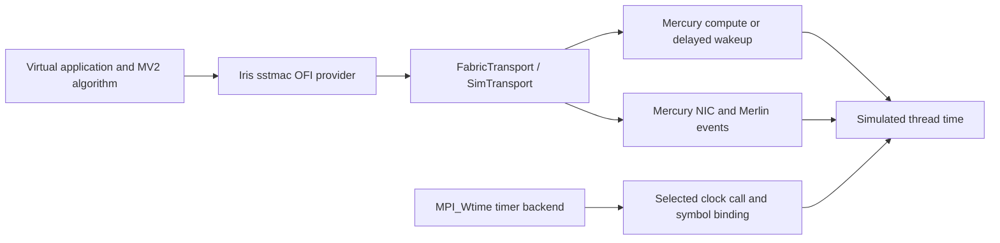

---
{
  "type": "SST Runtime Guide",
  "title": "MV2 timing through Mercury and Iris",
  "description": "Trace MPI clock selection, modeled event costs, sleep binding, and effective versus declared timing controls.",
  "tags": [
    "mv2",
    "timing",
    "mercury",
    "iris"
  ],
  "status": "draft",
  "generated": {
    "by": "sst-ai-tools/codex",
    "at": "2026-10-07T18:59:42.677733+00:00"
  },
  "sources": [
    {
      "resource": "https://github.com/nab880/mv2-test/blob/0bd13efd074affc7c8e3cca5add42af699362748/configure.ac",
      "x-commit": "0bd13efd074affc7c8e3cca5add42af699362748",
      "x-sha256": "5d4d7548e4ad9b9562b04777af2cdf0a3f9de2c3e7c4b69ae54255ac9353cf00",
      "x-review-scope": "External checkout inspected locally; automatic freshness checking unavailable",
      "id": "s0"
    },
    {
      "resource": "https://github.com/nab880/mv2-test/blob/0bd13efd074affc7c8e3cca5add42af699362748/src/mpi/timer/wtime.c",
      "x-commit": "0bd13efd074affc7c8e3cca5add42af699362748",
      "x-sha256": "70c059bebe542b1fd87fa97d2237a05ac77effa5a8553bf2a72ee30c5b08f6dd",
      "x-review-scope": "External checkout inspected locally; automatic freshness checking unavailable",
      "id": "s1"
    },
    {
      "resource": "https://github.com/nab880/mv2-test/blob/0bd13efd074affc7c8e3cca5add42af699362748/src/util/timers/mpiu_timer.c",
      "x-commit": "0bd13efd074affc7c8e3cca5add42af699362748",
      "x-sha256": "b347166c78a08baa93148dbaf3d4ed2ace38ba60e8aa6b990bf6e51df60f39cb",
      "x-review-scope": "External checkout inspected locally; automatic freshness checking unavailable",
      "id": "s2"
    },
    {
      "resource": "https://github.com/nab880/mv2-test/blob/0bd13efd074affc7c8e3cca5add42af699362748/build_linux.sh",
      "x-commit": "0bd13efd074affc7c8e3cca5add42af699362748",
      "x-sha256": "dc864c71a1d47af1926daa84ba215b4936be3cb590f18aeb14ed129f0e79fdb5",
      "x-review-scope": "External checkout inspected locally; automatic freshness checking unavailable",
      "id": "s3"
    },
    {
      "resource": "https://github.com/nab880/mv2-test/blob/0bd13efd074affc7c8e3cca5add42af699362748/build_mac.sh",
      "x-commit": "0bd13efd074affc7c8e3cca5add42af699362748",
      "x-sha256": "c7960921198f7bccf9a6a8c6ddd00c1039f5240abd7e067d5a79ee26e44fbc6a",
      "x-review-scope": "External checkout inspected locally; automatic freshness checking unavailable",
      "id": "s4"
    },
    {
      "resource": "https://github.com/jmlapre/sst-hgcc/blob/41cd313574c994f6fefe2c361124e854b7e4ac0f/replacements/time.h",
      "x-commit": "41cd313574c994f6fefe2c361124e854b7e4ac0f",
      "x-sha256": "449d33d9e5866c368296d35ad10f7719df3558bb477af8551a3ad7a1204ad4dd",
      "x-review-scope": "External checkout inspected locally; automatic freshness checking unavailable",
      "id": "s5"
    },
    {
      "resource": "https://github.com/jmlapre/sst-hgcc/blob/41cd313574c994f6fefe2c361124e854b7e4ac0f/replacements/sys/time.h",
      "x-commit": "41cd313574c994f6fefe2c361124e854b7e4ac0f",
      "x-sha256": "bcd2e0bd5b2a4875b97d96ac349ff77a03cd3110e03081346d27d1fbaf546d0f",
      "x-review-scope": "External checkout inspected locally; automatic freshness checking unavailable",
      "id": "s6"
    },
    {
      "resource": "https://github.com/jmlapre/sst-hgcc/blob/41cd313574c994f6fefe2c361124e854b7e4ac0f/support/mv2/mv2_mpi_wrappers.c",
      "x-commit": "41cd313574c994f6fefe2c361124e854b7e4ac0f",
      "x-sha256": "e80c96e0c40d0a26d2b0368917ccf55bd9900a62e661cda03dea4fb8e3179ab9",
      "x-review-scope": "External checkout inspected locally; automatic freshness checking unavailable",
      "id": "s7"
    },
    {
      "resource": "https://github.com/jmlapre/sst-hgcc/blob/41cd313574c994f6fefe2c361124e854b7e4ac0f/tests/mv2/platform_file_mv2_test.py",
      "x-commit": "41cd313574c994f6fefe2c361124e854b7e4ac0f",
      "x-sha256": "d2ec55172ba8f44f44e7632e1de67385d074646e394a36dc4f23b47361a22704",
      "x-review-scope": "External checkout inspected locally; automatic freshness checking unavailable",
      "id": "s8"
    },
    {
      "resource": "https://github.com/jmlapre/sst-hgcc/blob/41cd313574c994f6fefe2c361124e854b7e4ac0f/hglink.py",
      "x-commit": "41cd313574c994f6fefe2c361124e854b7e4ac0f",
      "x-sha256": "d1bc8eea70077debc697fa0db9eccc766fa39158e9a4cbfb704f9baccfab33d5",
      "x-review-scope": "External checkout inspected locally; automatic freshness checking unavailable",
      "id": "s9"
    },
    {
      "resource": "https://github.com/sstsimulator/sst-elements/blob/47b99537882df309fa2bdb2eb60c9a1e16efb5e5/src/sst/elements/mercury/common/hgcc_wrappers.cc",
      "x-commit": "47b99537882df309fa2bdb2eb60c9a1e16efb5e5",
      "x-sha256": "b83ed65c0a98e226c0954e8e5851ae883ea4ea7a57c70e96a79b2b778c67a15c",
      "x-repository": "sst-elements",
      "x-path": "src/sst/elements/mercury/common/hgcc_wrappers.cc",
      "id": "s10"
    },
    {
      "resource": "https://github.com/sstsimulator/sst-elements/blob/47b99537882df309fa2bdb2eb60c9a1e16efb5e5/src/sst/elements/mercury/common/skeleton.cc",
      "x-commit": "47b99537882df309fa2bdb2eb60c9a1e16efb5e5",
      "x-sha256": "269cc23b043e1cb2e7684a11e917491ca6c7a16083f1a4aa47c34dcf6beb2c99",
      "x-repository": "sst-elements",
      "x-path": "src/sst/elements/mercury/common/skeleton.cc",
      "id": "s11"
    },
    {
      "resource": "https://github.com/sstsimulator/sst-elements/blob/47b99537882df309fa2bdb2eb60c9a1e16efb5e5/src/sst/elements/mercury/libraries/compute/compute_library.cc",
      "x-commit": "47b99537882df309fa2bdb2eb60c9a1e16efb5e5",
      "x-sha256": "66b40d418015ed81d10895959ee7bd69ec82cf0a6bd26ffa06a5124c28543398",
      "x-repository": "sst-elements",
      "x-path": "src/sst/elements/mercury/libraries/compute/compute_library.cc",
      "id": "s12"
    },
    {
      "resource": "https://github.com/sstsimulator/sst-elements/blob/47b99537882df309fa2bdb2eb60c9a1e16efb5e5/src/sst/elements/mercury/libraries/compute/instruction_processor.cc",
      "x-commit": "47b99537882df309fa2bdb2eb60c9a1e16efb5e5",
      "x-sha256": "e6b35584ad3b08bdbe6b4a99780824575b7a2c439c5a8016d278085c8d422d36",
      "x-repository": "sst-elements",
      "x-path": "src/sst/elements/mercury/libraries/compute/instruction_processor.cc",
      "id": "s13"
    },
    {
      "resource": "https://github.com/sstsimulator/sst-elements/blob/47b99537882df309fa2bdb2eb60c9a1e16efb5e5/src/sst/elements/mercury/libraries/compute/memory_model.cc",
      "x-commit": "47b99537882df309fa2bdb2eb60c9a1e16efb5e5",
      "x-sha256": "dfbed374c87f7fb5dc70f08d34af1c79c8c7691a24434f0131b4148bc89ae8ac",
      "x-repository": "sst-elements",
      "x-path": "src/sst/elements/mercury/libraries/compute/memory_model.cc",
      "id": "s14"
    },
    {
      "resource": "https://github.com/sstsimulator/sst-elements/blob/47b99537882df309fa2bdb2eb60c9a1e16efb5e5/src/sst/elements/mercury/pymercury.py",
      "x-commit": "47b99537882df309fa2bdb2eb60c9a1e16efb5e5",
      "x-sha256": "28b879fca429a047cfac23554d31aef4c02b6f1271831d8cb06b14c54e24e718",
      "x-repository": "sst-elements",
      "x-path": "src/sst/elements/mercury/pymercury.py",
      "id": "s15"
    },
    {
      "resource": "https://github.com/sstsimulator/sst-elements/blob/47b99537882df309fa2bdb2eb60c9a1e16efb5e5/src/sst/elements/iris/sumi/sim_transport.cc",
      "x-commit": "47b99537882df309fa2bdb2eb60c9a1e16efb5e5",
      "x-sha256": "cb48a9e1b5fb5189c59651f6f9cf4ca9bcc95eba87a2176eb5802399b37a4ff7",
      "x-repository": "sst-elements",
      "x-path": "src/sst/elements/iris/sumi/sim_transport.cc",
      "id": "s16"
    },
    {
      "resource": "https://github.com/sstsimulator/sst-elements/blob/47b99537882df309fa2bdb2eb60c9a1e16efb5e5/src/sst/elements/iris/sumi/transport.h",
      "x-commit": "47b99537882df309fa2bdb2eb60c9a1e16efb5e5",
      "x-sha256": "b2be97dfeb3eb5fa1f0c91540fbbb22a1eeb7b8e52daabf0265a33d808c8785a",
      "x-repository": "sst-elements",
      "x-path": "src/sst/elements/iris/sumi/transport.h",
      "id": "s17"
    },
    {
      "resource": "https://github.com/sstsimulator/sst-elements/blob/47b99537882df309fa2bdb2eb60c9a1e16efb5e5/src/sst/elements/iris/libfabric/prov/sumi/src/sumi_ep.cc",
      "x-commit": "47b99537882df309fa2bdb2eb60c9a1e16efb5e5",
      "x-sha256": "0c393adab9ac0cb076ebc0a31cbf176c3e676e1f28ed98c3ef2856bd2490438a",
      "x-repository": "sst-elements",
      "x-path": "src/sst/elements/iris/libfabric/prov/sumi/src/sumi_ep.cc",
      "id": "s18"
    },
    {
      "resource": "https://github.com/sstsimulator/sst-elements/blob/47b99537882df309fa2bdb2eb60c9a1e16efb5e5/src/sst/elements/iris/libfabric/prov/sumi/src/sumi_mr.cc",
      "x-commit": "47b99537882df309fa2bdb2eb60c9a1e16efb5e5",
      "x-sha256": "086c6ef7a26b7b5119c44336040e7e63887dbf92bb86a169aadce90b738640fa",
      "x-repository": "sst-elements",
      "x-path": "src/sst/elements/iris/libfabric/prov/sumi/src/sumi_mr.cc",
      "id": "s19"
    },
    {
      "resource": "https://github.com/sstsimulator/sst-elements/blob/47b99537882df309fa2bdb2eb60c9a1e16efb5e5/src/sst/elements/mask-mpi/mpi_queue/mpi_queue.cc",
      "x-commit": "47b99537882df309fa2bdb2eb60c9a1e16efb5e5",
      "x-sha256": "a2e19bf169c8ff953176468cda21c269d78433fcd93665ef66686f3986d6c87d",
      "x-repository": "sst-elements",
      "x-path": "src/sst/elements/mask-mpi/mpi_queue/mpi_queue.cc",
      "id": "s20"
    },
    {
      "resource": "https://github.com/sstsimulator/sst-elements/blob/47b99537882df309fa2bdb2eb60c9a1e16efb5e5/src/sst/elements/mask-mpi/mpi_protocol/rendezvous_rdma.cc",
      "x-commit": "47b99537882df309fa2bdb2eb60c9a1e16efb5e5",
      "x-sha256": "1523e61025dd3fe931037dd239ea9b8a452211db7c51f67b99084480b0049675",
      "x-repository": "sst-elements",
      "x-path": "src/sst/elements/mask-mpi/mpi_protocol/rendezvous_rdma.cc",
      "id": "s21"
    },
    {
      "id": "s22",
      "resource": "https://github.com/sstsimulator/sst-elements/blob/47b99537882df309fa2bdb2eb60c9a1e16efb5e5/src/sst/elements/iris/libfabric/prov/sumi/src/sumi_cq.cc",
      "x-commit": "47b99537882df309fa2bdb2eb60c9a1e16efb5e5",
      "x-sha256": "6a5c57b0fab87fd643473158299e4f02c6cf8930e0409bf104fcc6b0bb87cae7",
      "x-repository": "sst-elements",
      "x-path": "src/sst/elements/iris/libfabric/prov/sumi/src/sumi_cq.cc"
    },
    {
      "id": "s23",
      "resource": "https://github.com/sstsimulator/sst-elements/blob/47b99537882df309fa2bdb2eb60c9a1e16efb5e5/src/sst/elements/iris/libfabric/prov/sumi/src/sumi_fabric.cc",
      "x-commit": "47b99537882df309fa2bdb2eb60c9a1e16efb5e5",
      "x-sha256": "ea1bf3196e45ff6d66233d760e07ff5cb237e346ef955cb7de2ce227c78b5353",
      "x-repository": "sst-elements",
      "x-path": "src/sst/elements/iris/libfabric/prov/sumi/src/sumi_fabric.cc"
    },
    {
      "id": "s24",
      "resource": "https://github.com/sstsimulator/sst-elements/blob/47b99537882df309fa2bdb2eb60c9a1e16efb5e5/src/sst/elements/iris/libfabric/prov/sumi/include/sumi_prov.h",
      "x-commit": "47b99537882df309fa2bdb2eb60c9a1e16efb5e5",
      "x-sha256": "b7fabf9d457c8ef605eda88b2403c12abf858f792b9e0ffcbfc4d47b2c2c8cea",
      "x-repository": "sst-elements",
      "x-path": "src/sst/elements/iris/libfabric/prov/sumi/include/sumi_prov.h"
    },
    {
      "id": "s25",
      "resource": "https://github.com/nab880/mv2-test/blob/0bd13efd074affc7c8e3cca5add42af699362748/src/mpid/ch3/channels/nemesis/netmod/ofi/ofi_progress.c",
      "x-commit": "0bd13efd074affc7c8e3cca5add42af699362748",
      "x-sha256": "4415a50a50f7e3b5f3cccb1a3f94905817e96a53efa2723bffe0341d741aba25",
      "x-review-scope": "External source inspected locally; freshness review is manual"
    },
    {
      "id": "s26",
      "resource": "https://github.com/nab880/mv2-test/blob/0bd13efd074affc7c8e3cca5add42af699362748/src/mpid/ch3/channels/nemesis/netmod/ofi/ofi_init.c",
      "x-commit": "0bd13efd074affc7c8e3cca5add42af699362748",
      "x-sha256": "2ba7a5914f558c50f6fc37fb2554e603fa7f321e0188926eb8d90838812eb113",
      "x-review-scope": "External source inspected locally; freshness review is manual"
    },
    {
      "id": "s27",
      "resource": "https://github.com/nab880/mv2-test/blob/0bd13efd074affc7c8e3cca5add42af699362748/src/mpid/ch3/channels/nemesis/netmod/ofi/ofi_tagged_template.c",
      "x-commit": "0bd13efd074affc7c8e3cca5add42af699362748",
      "x-sha256": "f9eddfa049f09cfeb81105355de6f51badcb00ce1b5e644b0bd09a1db7037887",
      "x-review-scope": "External source inspected locally; freshness review is manual"
    },
    {
      "id": "s28",
      "resource": "https://github.com/sstsimulator/sst-elements/blob/47b99537882df309fa2bdb2eb60c9a1e16efb5e5/src/sst/elements/iris/sumi/sim_transport.h",
      "x-repository": "sst-elements",
      "x-path": "src/sst/elements/iris/sumi/sim_transport.h",
      "x-commit": "47b99537882df309fa2bdb2eb60c9a1e16efb5e5",
      "x-sha256": "68777bfa01d8a5d32a8c278b08016695a27488ddeaebb2280a5fa2a194657463"
    },
    {
      "id": "s29",
      "resource": "https://github.com/sstsimulator/sst-elements/blob/47b99537882df309fa2bdb2eb60c9a1e16efb5e5/src/sst/elements/mercury/common/timestamp.h",
      "x-repository": "sst-elements",
      "x-path": "src/sst/elements/mercury/common/timestamp.h",
      "x-sha256": "a7d08b7e28c17e4d9059d71ae8939dac6abf96b4e4cfd8ac2b78ceceda2c50d0",
      "x-commit": "47b99537882df309fa2bdb2eb60c9a1e16efb5e5"
    },
    {
      "id": "s30",
      "resource": "https://github.com/sstsimulator/sst-elements/blob/47b99537882df309fa2bdb2eb60c9a1e16efb5e5/src/sst/elements/mercury/components/operating_system_impl.cc",
      "x-repository": "sst-elements",
      "x-path": "src/sst/elements/mercury/components/operating_system_impl.cc",
      "x-sha256": "e457c5886a49dd4c327d7d679de4a69c7bb7d4a72a2bdaaf6703bb29718131e6",
      "x-commit": "47b99537882df309fa2bdb2eb60c9a1e16efb5e5"
    }
  ]
}
---

# MV2 timing through Mercury and Iris

## Separate clock reads from modeled cost

In this integration, adapted MV2 code selects algorithms and drives communication; Mercury/Iris and the selected network execute modeled events. Reading a timer reports a clock value. It does not, by itself, charge MPI computation, polling, memory copying, or network latency.

The clock branch reaches simulated time only if the selected backend and transformed/bound implementation actually do so. The October 7, 2026 run produced completion times (two-rank send/receive 4.85879 us, eight-rank collectives 21.8 to 24.5 us, a staged two-rank probe 7.51319 us) but no clock-backend check accompanied them, so they are not validated `MPI_Wtime` behavior. A run that ends at `18.4467 Ms` has timed nothing: that is 2^64 ps, the stamp of a drained event queue after every rank blocked.

## 1. MPI_Wtime and timer backend selection

The inspected MV2 `MPI_Wtime`/`PMPI_Wtime` calls `MPID_Wtime` and converts the selected timestamp to seconds. Configure supports `--enable-timer-type`, including `clock_gettime`, `gettimeofday`, `mach_absolute_time`, device timers, and selected cycle counters. Selection is a build-time property of the MPI library, not merely an application setting.

| Clock/backend | Inspected integration path | What to verify |
|---|---|---|
| `gettimeofday` | HGCC replacement maps it to `SSTMAC_gettimeofday`; Mercury reads current simulated thread time truncated to whole microseconds (integer division in the misleadingly named `usecRounded()`) | MV2 timer object was rebuilt with the replacement and binds that symbol |
| `clock_gettime` | Replacement maps it to `HGCC_clock_gettime`; Mercury returns simulated thread time truncated to whole nanoseconds (`nsecRounded()`) | Correct header transformation and symbol binding; wrapper ignores the clock ID |
| `mach_absolute_time` or hardware cycle counter | Native timer implementation exists in the MPI source; no matching simulated-time replacement was established in this review | Do not report its native counter as simulated elapsed time without an explicit bridge |
| Device timer | Defined by the selected device implementation | Trace the actual device callback; name alone establishes no time domain |

The supplied MV2 build scripts list system replacement headers but do not explicitly list `time.h` or `sys/time.h`. The support MPI wrapper file does not provide an MPI_Wtime/PMPI_Wtime override. They also pass no `--enable-timer-type`, so configure autodetects the timer (its documented preference order is gethrtime, then clock_gettime, then gettimeofday); record the selected backend from configure output. `replacements/time.h` declares `HGCC_clock_gettime` only when `_POSIX_VERSION > 199309`, while its `#define clock_gettime` is unconditional. Therefore these recipes alone do not prove MPI_Wtime reads simulated time. Inspect preprocessed/rewritten timer source, configure output, and linked symbols; a forced backend such as `--enable-timer-type=clock_gettime` also needs a compatible clock replacement and a rebuilt archive.

Rebuilding only the application cannot retroactively transform clock calls already compiled into `libmpi_nopmi.a`. The inspected Mercury wrappers require an active simulated thread; invoking them as ordinary standalone host functions is not the same execution context.

Microsecond truncation can make small positive simulated intervals appear zero through gettimeofday. Nanosecond output is still truncated and is not proof of the simulator's internal resolution. Measure elapsed differences on the appropriate rank and do not infer globally synchronized MPI clocks merely because a timestamp API exists.

## 2. Sleeps, waits, and backoff

Mercury's `ssthg_sleep`, `ssthg_usleep`, and `ssthg_nanosleep` schedule a delayed unblock event and block the current virtual thread. Their time arguments use seconds, microseconds, and nanoseconds respectively. `ComputeLibrary::compute`/`sleep` also advance modeled execution by blocking until a simulated timeout.

However, the inspected MV2 **link support defines its own `hgcc_usleep` that returns zero without advancing time**. This differs from Mercury's `hgcc_usleep`, which calls the simulated microsecond sleep. Both Linux and Darwin MV2 link paths include the support wrapper object. Establish the bound symbol before assuming polling/backoff sleep is modeled.

There is also an active provider-level progress delay: `sumi_cq.cc` calls `OperatingSystem::blockTimeout` when a nonblocking CQ read finds no next completion. **`SUMI_CQ_NONBLOCK_YIELD_NS` defaults to 1 ns**; zero disables the yield, and the value is cached on first use. MV2's inspected OFI progress function calls `fi_cq_read`, so this is a concrete progress/timing path independent of `poll_delay` and the no-op `hgcc_usleep`. A read requesting several entries can yield after consuming a partial batch. The routine checks the queue before yielding and does not recheck it afterward in that call; no entries consumed means it returns `-FI_EAGAIN`. Avoid holding a mutex across this yield if another simulated thread needs it to progress.

MV2's OFI poll also carries `#pragma sst blocking condition(in_blocking_poll && ret == 0) api(libfabric)`. When the rewriter emits its blocking hook, `sst_hg_blocking_call` sets transport state that `configureNextPoll` consumes once, converting the next poll into a simulated blocking wait. Such a poll follows the blocking queue path instead of the nonblocking empty-poll yield. `configureNextPoll` is also consumed by `SimTransport::poll`, so a pragma-set blocking flag applies to whichever poll runs next, an OFI CQ read or an internal transport poll. Inspect the transformed MPI library to establish which path actually executes; a native compiler can ignore the pragma.

A native busy loop, a no-op sleep, and a simulated block have different effects on host usage, simulation progress, and modeled time. Preserve protocol progress and explicitly account for any CPU/backoff cost required by the experiment. Do not add a delay to every MPI call without checking whether the same cost is already charged below it.

The current timespec nanosleep wrapper clamps its total nanoseconds to an unsigned-int maximum before scheduling; long sleeps need explicit boundary tests. It is not a full POSIX signal/interruption model, and the clock_gettime wrapper does not preserve distinctions among real-time, monotonic, and CPU-time clock IDs.

## 3. Costs charged on the Mercury/Iris/network path

| Mechanism | Current source behavior | Scope/limit |
|---|---|---|
| `post_header_delay` | `SimTransport::send` calls modeled compute for posted sends and non-self small-message sends | Applied at that message path, not automatically once per high-level MPI operation |
| `post_rdma_delay` | Modeled compute before RDMA-get request / RDMA-put payload injection | A small ordinary send may never touch this hook |
| Network transfer | Provider calls transport postSend/RDMA methods; Mercury NIC and Merlin execute transfers | Link/router latency, bandwidth, flits, buffers and contention determine the exercised network path |
| `rdma_pin_latency`, `rdma_page_delay`, `rdma_page_size` | `pinRdma(bytes)` computes fixed cost plus rounded-up page-count cost | Mask-MPI rendezvous callers invoke it; reviewed OFI MR-registration handlers do not, so MV2 registration is not automatically charged |
| `poll_delay` | Parsed/stored by the reviewed SimTransport source | No use of the stored member was found; use the distinct OFI CQ-yield path below when studying MV2 progress |
| `SUMI_CQ_NONBLOCK_YIELD_NS` | Empty nonblocking OFI CQ polls schedule a simulated timeout; default 1 ns | Cached once; zero disables yielding; no per-successful-completion delay |
| Compute frequency/parallelism | NodeCL instruction model computes operation delay from counts, frequency and parallelism | Requires a compute hook/event; ordinary host execution of a function does not automatically incur this model |
| Memory-flow bandwidth/channels | Compute memory model schedules byte flows over modeled channels | Applies only where the workload/library actually requests modeled memory access |

For the existing pin-cost function:

`pin cost = rdma_pin_latency + ceil(bytes / rdma_page_size) * rdma_page_delay`

That is a source formula, not a measured MV2 result. For example, fi_mr_reg in the reviewed provider allocates metadata and returns success without calling pinRdma. It also omits assigning the caller's `*mr` handle; registration correctness needs validation before using that path for timing experiments (see [provider limits](../iris/fabrics.md)). Adding model parameters cannot create that missing call path. `pinRdma` always calls `compute()` even when the computed cost is zero, so each Mask-MPI rendezvous incurs a `blockTimeout(0)` yield, and the stored `pin_delay_` is never consulted. Every one of these hooks goes through the application's `ComputeLibrary`, resolved by name without a null check; an MV2 application must list `computelibrary:ComputeLibrary` for any post-send, RDMA, pin, or memcpy cost to exist.

The operation-count model uses approximately `(flops + integer ops) / (frequency * parallelism)`, then divides instruction time by its modeled thread count. For memory above the negligible-byte threshold it goes through the flow model, so the complete elapsed duration can include queuing/bandwidth effects. `compute_library_access_width` is interpreted as bits and divided by eight; the sample value 512 implies 64-byte modeled accesses. Loop-overhead and integer-operation accounting must be checked alongside the generated compute hooks. `computeBlockMemcpy` uses `bytes / access_width_bytes` with integer division, so sub-width transfers produce zero modeled loops and remainders are dropped in this path; an access-width setting is not a guarantee that every requested byte is charged.

## 4. Example platform values versus active controls

The inspected MV2 platform sets 2.1GHz compute frequency, four 11.2GB/s memory channels, 12GB/s network links, 8-byte flits, and 20ns link/router latency entries. It also declares 88us post-RDMA delay, 0.36us post-header delay, zero poll delay, 5.43us pin latency, 50.50ns page delay and a 4096-byte page size. These are example model inputs, not calibrated recommendations or validated observed costs.

A parameter being accepted by `HgOS` or appearing in a platform file does not prove that MV2 consumes it. In particular, `max_vshort_msg_size`, `max_eager_msg_size`, and `use_put_window` are read by the Mask-MPI queue in the reviewed source. They do not automatically tune the embedded MV2 implementation's protocol thresholds. MV2 tuning variables matter only for the compiled channel/algorithm actually used.

One provider setting does reach MV2 protocol selection: `SUMI_FI_INJECT_SIZE` changes the advertised `tx_attr->inject_size` (default 64 bytes, positive overrides capped at 16384 bytes, cached on first use). MV2 OFI initialization copies it into `gl_data.max_buffered_send`, which its send path uses to choose tagged injection versus the larger-message path. This is a protocol threshold, not a latency charge; record it when sweeping message sizes.

SUMI's `eager_cutoff` and collective selectors are likewise distinct from MV2's own algorithm selection. If a chosen MPI path bypasses OFI—for example, a local/shared-memory operation—the modeled network hooks may not determine its elapsed time. Trace the selected path before attributing a curve to bandwidth or a named collective policy.

## 5. Timing acceptance plan

1. Verify numerical correctness and natural completion first, using a known point-to-point case and the eight-rank SUM=36 fixture.
2. Record MPI timer backend, rewritten clock call, bound symbol, virtual-rank placement, exact platform values and installed libraries. Keep host elapsed time in a separate field.
3. Compare a clock read before/after a known **simulated** delay in an active Mercury thread. Test short intervals and rounding boundaries. If this does not track the imposed delay, do not use MPI_Wtime for simulation timing claims.
4. Exercise small posted sends and RDMA-sized operations separately. Change one verified active delay at a time and observe the corresponding hook count and elapsed change; do not sum every rank's delays as wall-clock completion time.
5. Sweep message sizes across the MPI implementation's actual protocol transitions. Confirm that the requested threshold changes the executed path, not only the configuration text.
6. Test polling/progress with and without traffic and known modeled work. Record `SUMI_CQ_NONBLOCK_YIELD_NS`, test its active CQ path, and check for no-op sleep/busy-loop behavior and double-counted overhead. Change cached provider environment settings between fresh SST processes.
7. Compare equivalent configurations on Linux/macOS for correctness and the simulated time domain before comparing timings. Match model inputs, ABI/toolchain/runtime changes and rank mappings; equal host runtime is not required.

The resulting durations reflect the modeled event schedule and its critical path. Computation/communication overlap, concurrency, blocking and contention can prevent a simple sum of per-call delays from predicting whole-application time.

Use [platform support details](mv2-platforms.md), [the MV2 installation guide](../../development/mv2-install.md), and [Iris fabrics](../iris/fabrics.md) to resolve the concrete path. This document is source-reviewed; no new MV2 timing measurements are claimed.
